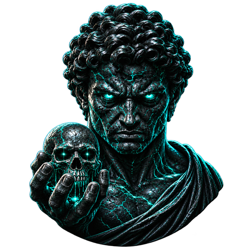
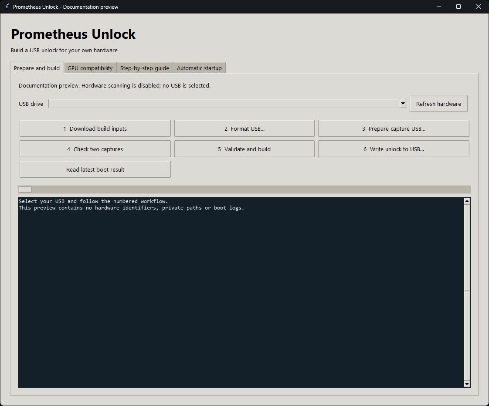
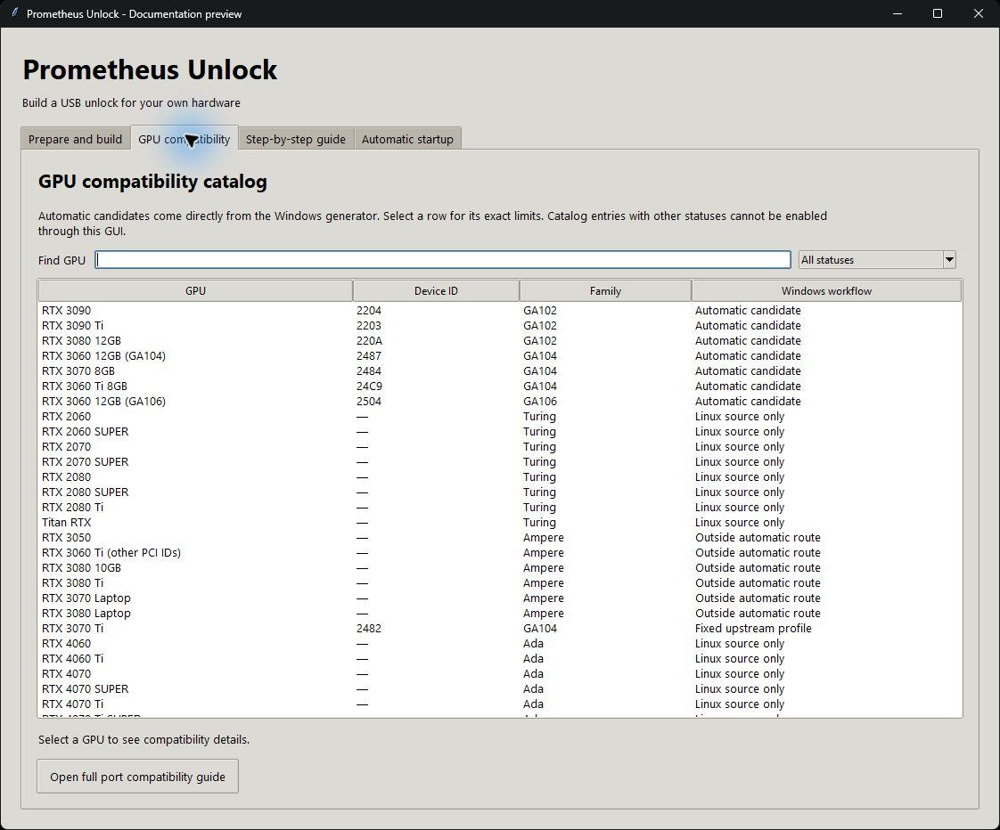
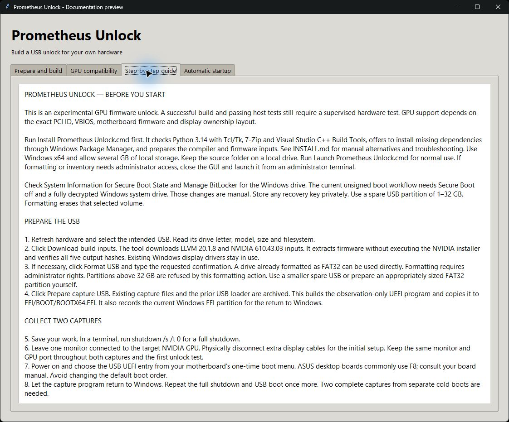
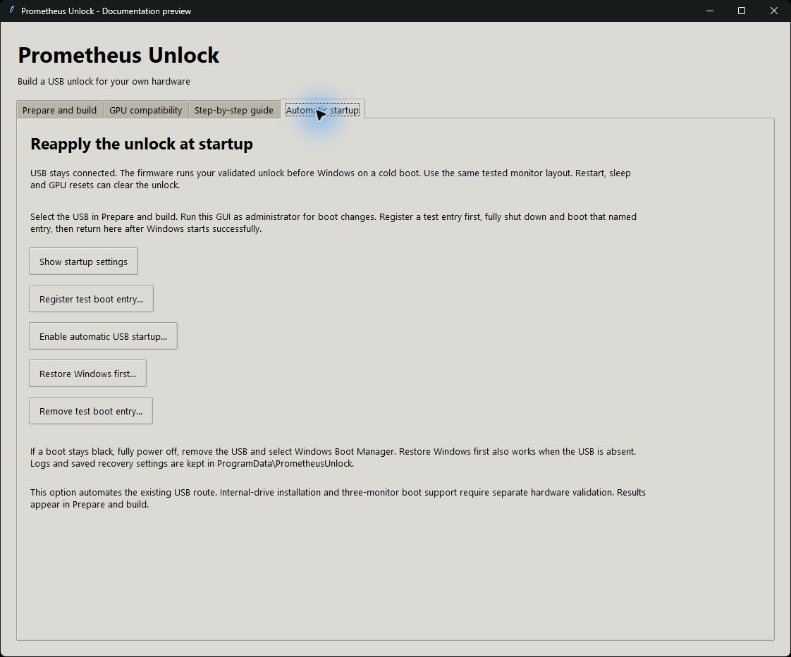

  

# Prometheus Unlock

A Windows desktop assistant for building an experimental NVIDIA GPU unlock USB for your own hardware. Based on Windows-GPU-UNLOCK commit `c6bc2b31eedeedd6c36e8dbaed50359a757335d3`, with original source, licensing and documentation included.

## Step-by-step installation and setup

### 1. Download and extract

On GitHub, choose **Code → Download ZIP**, or download the prepared source ZIP from a release if available. Extract the entire archive into a writable folder such as `C:\Tools\Prometheus Unlock`. Do not run the launchers from inside the ZIP or move them away from the other project files.

Use x64 Windows, an eligible GPU from the table below, internet access, several GB of free space and a spare USB with a 1–32 GB FAT32 volume. Back up the USB before formatting; formatting erases the selected volume. Additional storage is needed for the C++ tools.

### 2. Install the dependencies

Double-click **Install Prometheus Unlock.cmd**. Setup checks Python 3.14 with Tcl/Tk, 7-Zip and Visual Studio C++ Build Tools. If prompted, type `Y` to install missing dependencies using Windows Package Manager and approve the official installers' administrator prompts. Complete any requested restart and rerun setup.

Setup prepares LLVM and verifies the firmware build inputs, then opens the GUI. If a dependency cannot be installed automatically, follow [manual installation instructions](INSTALL.md#manual-dependency-installation). For later sessions, double-click **Launch Prometheus Unlock.cmd**.

### 3. Check compatibility and boot settings

Open the **GPU compatibility** tab and check your GPU's exact PCI device ID. A catalog listing alone does not mean the automatic workflow supports that card.

Open Windows **System Information** to check Secure Boot, and **Manage BitLocker** to check the system drive. This experimental port requires Secure Boot off and the Windows system drive fully decrypted. Necessary changes are manual; follow your motherboard documentation and retain recovery information privately. See [firmware boot settings](INSTALL.md#3-check-firmware-boot-settings).

### 4. Prepare the capture USB

1. Connect the spare USB and click **Refresh hardware**.
2. Verify the selected drive letter, model and capacity.
3. If needed, click **Format USB** and enter the requested erase confirmation. An existing FAT32 volume can skip formatting. Formatting requires launching the GUI as administrator.
4. Click **Prepare capture USB** and wait for successful completion.

### 5. Collect two cold-boot captures

1. Save your work and run `shutdown /s /t 0` in a terminal.
2. Leave one monitor connected to the target GPU; disconnect the other display cables for initial setup.
3. Power on, open your motherboard's one-time boot menu and select the USB's **UEFI** entry. Let the capture tool run and return to Windows.
4. Fully shut down and repeat the same USB boot once more, keeping the monitor and port unchanged.
5. Open the GUI, select the USB and click **Check two captures**. Resolve any rejection before continuing.

### 6. Validate and build

Click **Validate and build**. The tool generates your local hardware profile, runs the required host checks and builds the unlock. Wait for the complete operation to succeed. If it rejects your firmware or topology, follow the reported explanation; repeated boots do not add hardware support.

### 7. Write and boot the unlock

Click **Write unlock to USB** and review the confirmation. This replaces the capture loader with the actual experimental unlock program. Fully shut down and boot the USB again using the same monitor arrangement. Let the attempt finish and return to Windows. The initial five-second **Esc** window skips the attempt.

### 8. Verify the result

Click **Read latest boot result**. A fresh report ending in `FINAL status=0` and `clean=1`, together with Windows returning from that same attempt, records successful transaction completion. An old log does not prove the current GPU state. Compare the same workload and settings before and after to measure any benefit.

### 9. Optional automatic USB startup

After a successful manual boot, follow [Automatic USB startup](AUTOMATIC-STARTUP.md) to register an entry, physically test it and then enable automatic startup. Leave the USB connected and retain the tested monitor arrangement. This reapplies a volatile unlock; it is not a permanent hardware modification.

### Recovery and troubleshooting

If a boot stays at a black screen, fully power off, remove the USB and select **Windows Boot Manager**. For automatic startup recovery, use **Restore Windows first** after Windows starts. Preserve the failed attempt's logs privately before retrying.

See [INSTALL.md](INSTALL.md) for detailed setup, manual dependencies, script options and troubleshooting. The GUI also includes a **Step-by-step guide**.

## What it does

- Detects GPU, motherboard and USB volumes.
- Formats the selected USB volume as FAT32 after typed confirmation.
- Builds and stages a read-only UEFI capture tool.
- Checks two captures and generates an exact local hardware profile.
- Runs the upstream host tests and builds the experimental unlock.
- Copies the verified unlock build to USB after confirmation.
- Displays the latest boot result.
- Provides tested-entry registration, automatic USB startup, and Windows-first recovery through the **Automatic startup** tab. See [automatic startup instructions](AUTOMATIC-STARTUP.md).

## GUI screenshots

Actual application screenshots in a documentation preview with hardware scanning disabled. No personal hardware identifiers, local paths or boot logs are shown.

### Prepare and build

### GPU compatibility

### Step-by-step guide

### Automatic startup and recovery

## GPU coverage

The GUI has 35 searchable catalog entries, including additional Turing, Ampere and Ada models and an unsupported RTX 50-series entry. Informational entries do not enable unlocking. Only the seven exact PCI IDs below enter automatic profile validation.

| GPU candidate | NVIDIA PCI device ID |
| --- | --- |
| RTX 3060 12GB, GA104 | 2487 |
| RTX 3060 12GB, GA106 | 2504 |
| RTX 3060 Ti 8GB | 24C9 |
| RTX 3070 8GB | 2484 |
| RTX 3080 12GB | 220A |
| RTX 3090 | 2204 |
| RTX 3090 Ti | 2203 |

These IDs are candidates for the automatic local-profile workflow. Firmware hashes, PCI layout, display ownership and cold-state checks must also pass. The authoritative list is `research/profile/proven.json`, which populates the GUI. The port has a fixed RTX 3070 Ti/B660M profile, covered in its compatibility guide, but automatic local generation for arbitrary RTX 3070 Ti systems is unavailable.

Read the [full upstream compatibility guide](docs/COMPATIBILITY.en.md). RTX 20/40/50 series and other unlisted IDs are outside this GUI's automatic route.

## Experimental status

This is experimental software that changes GPU state before Windows starts. Software checks cannot guarantee successful boot, stability or performance on another machine. Keep Windows Boot Manager accessible and follow the recovery instructions. Automatic startup reapplies a volatile change; it is not a permanent firmware unlock.

The shared project contains source and tooling. Per-machine captures, profiles, firmware downloads and generated EFI programs are created locally during setup and use.

## Sharing and attribution

Run `python gui/package.py` to create `dist/Prometheus-Unlock-source.zip`. It uses the explicit `SOURCE-FILES.json` list to keep local generated files out of the package. After intentionally adding new public files, update that list. Run `python gui/release_check.py` before sharing. See [CONTRIBUTING.md](CONTRIBUTING.md) for validation commands and [RELEASE-VALIDATION.md](RELEASE-VALIDATION.md) for testing limits.

Original project documentation is preserved in [UPSTREAM-README.md](UPSTREAM-README.md). Original copyright and license notices are retained. NVIDIA firmware has its own license, extracted to `assets/NVIDIA-LICENSE`. See [GUI provenance](gui/README.md) for the source revisions and firmware extraction method.
